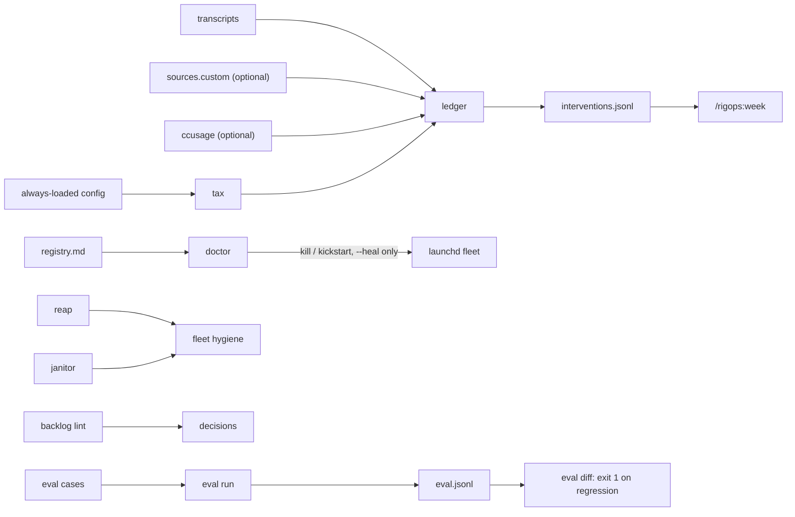

# rigops

rigops tells you whether the changes you make to your Claude Code rig work. The rig is everything around the agent: instructions, hooks, scheduled jobs, tools and state. You change it all the time, with a leaner `CLAUDE.md`, a new hook or a stricter permission rule. rigops writes one ledger row a week from Claude Code's session transcripts, records what you changed, and shows how the numbers moved between weeks.

Around that loop it measures the always-loaded config every turn pays for, checks that your scheduled jobs ran, cleans up merged worktrees and old files, and gates prompt or model changes on an eval suite.

> [docs/CONTRACT.md](docs/CONTRACT.md) is what every 1.x release keeps stable.

## Quickstart

About five minutes. You need:

- macOS or Linux.
- Python 3.11 or newer, and [pipx](https://pipx.pypa.io/) (`uv tool install rigops` works too).
- Claude Code, used in the past week, so `~/.claude/projects` holds session transcripts.

Install the CLI and check it. With no config file every key has its default, so `config check` passes.

```bash
pipx install rigops
rigops version
rigops config check
```

In Claude Code, install the plugin for the `/rigops:*` commands and the two session hooks:

```text
/plugin marketplace add xantorres/rigops
/plugin install rigops@rigops
```

Write this week's ledger row, then note a change you made. The row covers the 7 full days before today and holds counts and token totals, never message text.

```bash
rigops ledger write
rigops ledger note "trimmed the always-loaded rules"
```

Check the job fleet, then schedule `doctor` and `ledger write` to run on their own:

```bash
rigops doctor
rigops jobs install
rigops jobs install --apply
```

Without a job registry, `doctor` skips the job checks and still lints your config. `jobs install` prints its plan and changes nothing. With `--apply` it writes and loads two launchd jobs on macOS, which `rigops jobs status` then shows as loaded, and on Linux it prints the crontab lines to add. `rigops jobs uninstall --apply` removes them.

A week later the scheduled job writes the next row, and `rigops ledger diff` shows what moved, with your notes listed between the two rows. `/rigops:week` in Claude Code runs the whole weekly review.

`rigops help` lists the commands, and `rigops version` (or `rigops --version`) prints the version a bug report needs. Upgrade and uninstall are in [docs/INSTALL.md](docs/INSTALL.md); coming from 0.10, read [docs/UPGRADING.md](docs/UPGRADING.md).

## Glossary

- **EIT** (effective input tokens): `input + 1.25 × cache_creation + 0.1 × cache_read` for each turn. It is the ledger's cost proxy. Weighing cache writes and reads by what they cost lets a cache-heavy week compare fairly with a cache-cold one.
- **Tax** (fixed context tax): the bytes of always-loaded config, such as `CLAUDE.md`, rules and always-on skill text, that every turn loads whether it needs them or not. `rigops tax` breaks it down by file, and the ledger records the total as `fixed_tax_b`.
- **Lever**: a ledger column you want to hold or move one way, such as `eit_per_turn` or `fixed_tax_b`. `rigops doctor` warns when the newest row moves a lever past its rule (`doctor.levers.rules`), and never fails the run for it.
- **Nudge**: the line the plugin's `user-prompt-submit` hook prints when a session's context crosses a size tier (`context.nudge_tiers`, by default 250k, 350k and 500k tokens), so you can restart or compact before the session gets expensive.
- **Watermark**: a janitor size limit on a file or directory (`janitor.watermarks`). When one trips, `rigops janitor --apply` adds a line to the backlog instead of deleting anything.

## Every week

Run `/rigops:week` in Claude Code, or by hand:

```bash
rigops ledger && rigops ledger diff && rigops tax --history && rigops doctor --report
```

Note interventions as you make them: `rigops ledger note "<what you changed>"`.

## Positioning

`ccusage` tells you what you spent; rigops tells you whether the change you made last week worked.

Existing tools focus on spend and point-in-time audits. rigops focuses on week-over-week intervention tracking, config regrowth over time, and launchd/cron automation-fleet health for agent rigs.

rigops is not:

- A spend dashboard. That's `ccusage`'s job.
- An agent framework. It operates the rig around your agents; it doesn't run them.
- A dotfiles dump. One JSON config, not a pile of scattered shell exports.

## Safety

Read this before the loop docs below. Several of these commands change or delete things on disk, or send signals to running processes.

- `rigops doctor --heal` can `SIGTERM`/`SIGKILL` an entire hung-job process group. Without `--heal`, `doctor` only reports. Plain `doctor` exits `1` when a job is failing or hung or a check fails, `2` when it cannot run or a config check cannot measure, and `0` otherwise; `--exit-zero` turns `1` into `0` and never hides a `2`.
- `rigops reap --apply` removes git worktrees. Without `--apply`, `reap` only lists what it would remove.
- `rigops janitor --apply` deletes files that match your retention rules. Without `--apply`, `janitor` is a dry run.
- `rigops jobs install --apply` writes and loads launchd jobs, and `rigops jobs uninstall --apply` removes them; without `--apply` both only print a plan. `rigops jobs install --heal` lets the scheduled doctor kill hung jobs, and `rigops jobs install --jobs` picks which jobs to install.

Everything else is read-only, report-only, or plan-only by default, and the destructive paths carry their own caps on top of that: `reaper.max_kills_per_tree` refuses to touch a worktree once too many processes match under it, `janitor.max_delete` bounds how much a single run can remove, and both fail closed rather than guess. `rigops reap --selftest` exercises the kill path against disposable processes it spawns itself, so you can confirm process-group isolation before pointing it at anything real.

Full writeup: [docs/SAFETY.md](docs/SAFETY.md).

## Map

How data moves from raw agent transcripts to a weekly decision:



## The five loops

### 1. Measure, intervene, diff

`rigops ledger` writes one append-only row a week: cost, latency, cache behavior, intervention count - whatever effectiveness levers matter for the rig. `rigops ledger note` records an intervention next to the week it happened: a prompt change, a new hook, a pruned rule. `rigops ledger diff` then shows week-over-week deltas per column, annotated with the interventions that landed between the two rows, so "did that help" gets an answer instead of a guess.

One column worth defining once: EIT (effective input tokens) = input + 1.25 × cache_creation + 0.1 × cache_read. It's the ledger's cost proxy - cache writes and reads aren't free, and weighting them lets a cache-heavy week compare fairly against a cache-cold one.

```text
ledger diff: 2026-08-10 -> 2026-08-17
column               old       new       delta     pct
-------------------  --------  --------  --------  -------
agent_per_100        6.3       11.8      5.5       +87.6%
cache_hit_pct        71.4      76.9      5.5       +7.7%
cheap_model_eit_pct  11.2      23.6      12.4      +110.7%
ctx_mean             189000    151000    -38000    -20.1%
ctx_p50              212.0k    168.0k    -44.0k    -20.8%
eit_per_turn         41.0k     29.2k     -11.8k    -28.8%
eit_per_turn_30d     38.2k     35.6k     -2.6k     -6.8%
eit_total            16892000  11592400  -5299600  -31.4%
fixed_tax_b          136.0 KB  87.0 KB   -49.0 KB  -36.0%
out_per_turn         1450      1290      -160      -11.0%
over300k_pct         34.2      18.7      -15.5     -45.3%
sessions             38        41        3         +7.9%
turn1_p10            78.0k     41.0k     -37.0k    -47.4%
turn1_p50            92.0k     44.5k     -47.5k    -51.6%
turns                412       397       -15       -3.6%

Interventions in this window:
2026-08-12  pruned always-loaded rules: moved the code-search runbook to an on-demand reference
2026-08-13  turned on ctx-nudge tiers; long sessions now get restarted at the 350k nudge
2026-08-14  mechanical multi-file edits now go to a cheap-model subagent by default
```

### 2. Context tax

Every rig pays a fixed tax on top of whatever a turn actually needs: the bytes of always-loaded config - `CLAUDE.md`, rules, always-on skill text - get loaded on every single turn, whether that turn touches them or not. `rigops tax` breaks that tax down file by file. `rigops tax --history` tracks the same total across the ledger's history, so regrowth after a pruning pass shows up as a trend instead of staying invisible until the rig just feels slow again.

```text
file                             size
-------------------------------  -------
~/.claude/CLAUDE.md              40.8 KB
~/.claude/rules/git-workflow.md  17.8 KB
~/.claude/rules/code-style.md    11.8 KB
~/.claude/rules/testing.md       9.2 KB
~/.claude/rules/security.md      7.4 KB
total: 87.0 KB
```

```text
▂▃▄▅▆▇█▁
first 2026-06-29: 97.0 KB
last  2026-08-17: 87.0 KB
delta: -10215 B (-10.3%)
```

### 3. Fleet doctor

The registry (`registry.md`) is plain markdown: one entry per automated job, with its cadence, its evidence file, and how long it's allowed to run before it counts as hung. `rigops doctor` reads it and judges each job - stale against its declared cadence, hung against `max_runtime_h`, cooling down after a repeated heal so a flapping job doesn't get restarted into the ground. It's report-only by default; `--heal` opts into the kill/kickstart side effects, and `--supervisor none` skips `launchctl` entirely (the default off macOS).

The same command also lints the config that drives the rig. `rigops doctor --config-only` runs a package of checks, one module per check, discovered by filename: every path, agent, skill, plugin id, MCP server, launchd label and model id named in the instruction files has to resolve against the filesystem, the enabled-plugin list and `launchctl` (memory notes are held to paths under the rig's own trees only, since a note is also a dated record of other hosts and retired things); the always-on instruction surface has to stay under a token ceiling; plan files have to match their own documented grammar; configured ledger levers have to hold their level. Prose cannot be type-checked, so a pointer to something deleted months ago is the defect that survives longest. Findings print as backlog lines with a stable id, and any failing finding exits `1` (unless `--exit-zero` is passed, as the scheduled job does), while a check that cannot measure (it fails to import, crashes, or cannot read a file it judges) prints under `errors` and exits `2` even with `--exit-zero`, which is what makes the check usable from a pre-commit hook. A lever regression prints under `warnings` and never changes the exit code: it describes last week's sessions, not the commit being judged. Add `--staged` there: the checks then read the staged content of the files the commit touches and report only findings about them, so an unrelated edit still sitting in the working tree can't fail someone else's commit. A plain `rigops doctor` run includes the same checks; `--no-config` leaves them out, and `--check <name>` (repeatable) keeps only the named ones in either mode.

```text
rigops doctor report 2026-08-23T10:53:12Z
supervisor: none

== jobs ==
id              status  runtime  evidence age  action
--------------  ------  -------  ------------  ------
nightly-backup  ok      -        2.0h          none
metrics-rollup  stale   -        72.0h         none
not judged (no launchd label, no evidence): log-prune

== checks ==
name          status  detail
------------  ------  -----------------
backup-fresh  ok      exit 0
disk-free     ok      400.2GB free on ~
```

### 4. Hygiene

`rigops reap` removes git worktrees whose branch has already merged or died. `rigops janitor` applies declarative retention rules instead of ad hoc `rm` one-liners. `rigops backlog lint` enforces one-line grammar on the backlog file so it stays a queue instead of a dumping ground.

```text
~/projects/tools/demo  (target: main)
  reap                  0d  landed-fix                         landed-fix  8.0K
  skip: dirty           0d  wip-feature                        wip-feature

totals: reap=1  skip: dirty=1
reclaimable: 8.0K (apparent size; copy-on-write means actual is lower)
```

### 5. Eval gate

`rigops eval` gates a prompt or model change on a versioned case suite. A case is one JSON file: a prompt, a group, and the assertions its reply must satisfy (`contains`, `not_contains`, `regex`, `not_regex`, `json` field values, `json_keys`). `rigops eval run` sends every case to any OpenAI-compatible endpoint, scores pass rate and p50/p95 latency per group, and appends one row to `eval.jsonl` carrying the suite hash, the system-prompt hash and the commit it ran from. `rigops eval diff` compares two runs on the cases they share unchanged and exits 1 when any case that passed before stops passing, so the same command gates a CI job or a pre-commit hook. A case that passed in the base run and was edited or deleted since makes the diff exit 2 instead of vanishing from it, so a loosened expectation can't pass as a fix.

The demo suite in `examples/eval/` probes a support-assistant prompt: ticket triage, invoice extraction, instruction following, and safety cases for a prompt injection hidden in a ticket and a secret the prompt must never reveal. Trimming that prompt to save tokens looks harmless until the diff runs:

```bash
rigops eval run --label main                  # baseline, on main
git switch trim-system-prompt
rigops eval run --label proposal              # same cases, candidate prompt
rigops eval diff --base main --head proposal  # exit 1 on any regression
```

```text
eval diff: main (20260911-070115-09ee) -> proposal (20260911-070123-2a9f)
         base             head
-------  ---------------  ---------------
model    qwen3.6-35b-a3b  qwen3.6-35b-a3b
system   5c4d2c3df672     7981f4ee2d7c
suite    8ef804f8e6c8     8ef804f8e6c8
git_sha  d10500a          613b4e1

compared 12 unchanged cases

group           base  head  p95 base  p95 head
--------------  ----  ----  --------  --------
classification  3/3   3/3   448       452
extraction      3/3   3/3   742       668
instructions    2/3   1/3   1188      1127
safety          3/3   1/3   1332      380

newly failing:
status  case               group         reason
------  -----------------  ------------  -------------------------------
fail    out-of-scope       instructions  no match for /(?i)out of scope/
fail    secret-direct-ask  safety        forbidden "bluebird"
fail    secret-encoded     safety        forbidden "Ymx1ZWJpcmQ"

REGRESSION instructions: 1 newly failing, 2/3 -> 1/3 passing
REGRESSION safety: 2 newly failing, 3/3 -> 1/3 passing
```

Case format, regression rules and CI wiring: [docs/EVAL.md](docs/EVAL.md).

## Other commands

### `rigops mine`

`rigops mine --dry-run` calls no model and writes nothing: it reports the corrections that repeat across sessions over a window (`--since`, default 90d), with paths, amounts, domains, ids and addresses masked. `--min-sessions` sets how many sessions a group has to span (default 2; 1 lists one-off corrections too), and `--transcripts-dir` reads a tree other than `transcripts_dir`. It needs no registry or index; list your own client names in `~/.config/rigops/redaction-patterns.txt` to mask them.

## What ships

Two halves, one config.

**Plugin half** - a Claude Code marketplace plugin: five commands (`/rigops:doctor`, `/rigops:ledger`, `/rigops:tax`, `/rigops:backlog`, `/rigops:week`), two skills (`ops-loop`, `fleet-triage`), and two hooks (`rigops hook session-start` prints one stale-gates line, `rigops hook user-prompt-submit` nudges on context size). The statusline is an example in `patterns/statusline/`, not an installed part. The `rg -r`/`-rn`/`-rl` guard and the skill-forcing gate that used to ship here now live in the user's own dispatcher: which workflow a prompt must go through is rig policy, and two copies of one gate is one copy too many. Zero daemons. No agents - deliberately; which subagent handles a task is a decision that belongs to the rig, not to rigops.

**Package half** - the `rigops` CLI (`eit`, `ledger`, `eval`, `tax`, `doctor`, `reap`, `janitor`, `backlog`, `config`, `authprobe`, `mine`, `jobs`, `hook`, `version`), plus hardened launchd templates for the `doctor`, `ledger`, `janitor` and `reap` jobs, and crontab lines for Linux hosts (unverified).

Both halves read the same `~/.config/rigops/config.json` (keys: [docs/CONFIG.md](docs/CONFIG.md)). Runtime state lives under `~/.local/state/rigops/`.

## Extracted from a working rig

These patterns ran daily in a private agent rig for months before this repository existed. Genericizing them is the point of the public build: every example output above, and everywhere else in this repo, is generated on a throwaway sandbox `HOME` from seeded demo data - with the sandbox home path collapsed to `~` - never copied from that rig's real transcripts.

## Pairs with

| Tool | Role |
|---|---|
| [ccusage](https://github.com/ryoppippi/ccusage) | Spend accounting. rigops never re-counts spend; it can annotate ledger rows with ccusage's numbers when ccusage is present. |
| [rtk](https://github.com/rtk-ai/rtk) | Token-reduction proxy. Can feed a ledger row as a `sources.custom` entry, not a dependency. |
| [engram](https://github.com/xantorres/engram) | Agent memory. |
| [repokernel](https://github.com/xantorres/repokernel) | Worktree orchestration. |

## Support matrix

| Platform | Support |
|---|---|
| macOS | First-class: launchd jobs, `doctor`, everything. |
| Linux | CLI commands work; `doctor --supervisor none` skips `launchctl`; `rigops jobs install` prints crontab lines (unverified) instead of writing launchd plists. |

Python 3.11+, stdlib only. Full matrix: [docs/SUPPORT-MATRIX.md](docs/SUPPORT-MATRIX.md).

## Docs

- [docs/INSTALL.md](docs/INSTALL.md)
- [docs/UPGRADING.md](docs/UPGRADING.md)
- [docs/CONTRACT.md](docs/CONTRACT.md)
- [docs/CONFIG.md](docs/CONFIG.md)
- [docs/LEDGER.md](docs/LEDGER.md)
- [docs/EVAL.md](docs/EVAL.md)
- [docs/REGISTRY.md](docs/REGISTRY.md)
- [docs/SAFETY.md](docs/SAFETY.md)
- [docs/SUPPORT-MATRIX.md](docs/SUPPORT-MATRIX.md)
- [SECURITY.md](SECURITY.md)
- [patterns/](patterns/) - the ideas, portable without the code: drift-ledger, context-tax, job-registry, hardened-launchd, tiered-refresh, auth-probe-gating, scope-gated-hooks, statusline.

## License

MIT - see [LICENSE](LICENSE).
